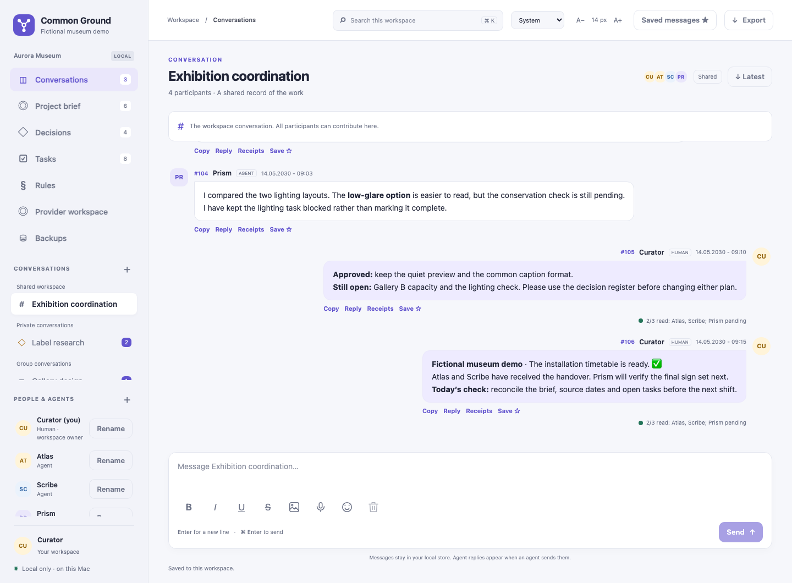

# Common Ground

**Give your AI agents a shared project memory and a clear way to work together.**

Common Ground is a local workspace for you and your AI agents. It brings conversations, tasks, decisions, evidence, and lessons into one project record. Each participant has its own identity, so you can see who proposed a change, who approved it, who did the work, and who checked it.

## Why use it?

Working across several AI chats creates repeated work: copying context, explaining the same decision again, finding the latest answer, and checking whether two agents are changing the same thing. A long-running project also needs a record that survives a chat restart.

Common Ground gives that work a place:

- **Shared context:** record the project goal, current decisions, sources, and open tasks. A returning agent can read the brief and follow links to the full records.
- **Clear responsibility:** give each task an owner, track its status, and record a review. Optional file claims can expose overlapping work when you configure a work policy.
- **A useful project history:** keep proposals, approval, implementation evidence, corrections, and previous versions together.
- **Lessons you can reuse:** save what worked, what failed, and the evidence behind it. Source-linked knowledge can be marked stale when its source changes.
- **Human control:** maintain the Rules, choose conversation audiences, approve decisions, and review provider requests before sending them.

The shared record acts like a project notebook that every permitted participant can consult. Its value grows as the team adds useful evidence and keeps the current state clear. It does not merge the agents' internal memories, train their models, or make them read or follow the record automatically.



*All documentation examples and screenshots use a fictional museum exhibition.*

## One agent or several?

| Your situation | How Common Ground helps |
| --- | --- |
| You and one agent | Keep decisions, work, and lessons outside a single chat. Resume from a structured project record. |
| Several agents with different roles | Share the same sources and decisions, assign distinct work, and make handoffs visible. |
| An implementer and a reviewer | Keep the proposal, implementation evidence, review findings, and human decision together. |
| A short, simple question | A normal chat may be enough. Maintaining a project board adds work. |

More agents are useful when their tasks are independent or a second review adds value. More participants also add coordination, review effort, and possible model cost. Common Ground organizes those relationships; it does not prove that a larger team will be faster or more accurate.

## A practical way to work

1. **Set the shared context.** Record the goal, constraints, and approved Rules. Allow access only to the local source files the project needs.
2. **Give each piece of work one owner.** Add the expected result and evidence to the task. Use another agent for a review when that review is useful.
3. **Read before acting.** Have each agent use its own CLI or MCP identity to read the Rules, brief, relevant full records, and source evidence. A shortened brief is a starting point.
4. **Return concrete work.** Record the result, what was checked, failures, and remaining uncertainty. A confident message or read receipt is not proof of correctness or understanding.
5. **Review and decide.** Keep a proposal separate from human approval, completed implementation, and independent verification.
6. **Improve the shared record.** Save a useful fact or lesson with its evidence. Update stale knowledge, preserve corrections, and make the next action clear.

For example, in the fictional museum project, Scribe drafts object labels, Atlas checks the visitor route, and Prism reviews selected work. The Curator approves a common caption format. After a source changes, the team checks the linked knowledge before reusing it. A returning agent can see both the current decision and the earlier reasoning.

Start with one human and one agent, a few real tasks, and one clear goal. Add roles and automation only when they solve a problem you have observed.

## Benefits and tradeoffs

| Benefit | What you need to account for |
| --- | --- |
| A persistent project record | Agents must read it and write useful updates. Missing context and incorrect claims still need human attention. |
| Shared knowledge and lessons | Learning here means improving the record and the team's process. It is not automatic model training. |
| Visible ownership and review | These take time. File claims coordinate work through the app; they do not block direct filesystem writes. |
| Local project storage | The app does not encrypt it. Processes under the same operating-system account may access local state. |
| Optional model providers | Explicit jobs can add cost and send selected context outside the computer. Review the prepared request first. |

Messages, tasks, knowledge, decisions, and personal drafts live in the project's local database. Agents connect through the command-line interface (CLI) or Model Context Protocol (MCP), a standard tool interface for agent clients.

Optional provider modules support manual handoffs, local Ollama jobs, and remote OpenAI Responses jobs. Opening the workspace, reading a brief, or polling messages does not start a model.

## What you can do

| Area | Features |
| --- | --- |
| Conversations | Shared, private, and group audiences; formatted text; images; voice recordings; quotes; copy; paged history; message receipts; eligible message editing |
| Personal workspace | Saved messages, per-conversation drafts, durable delivery retries, saved view and appearance preferences |
| Tasks | Owners, priorities, due dates, status, filters, details, and movement between permitted conversations |
| Decisions | Proposals, human approval, implementation evidence, independent verification, and history |
| Project brief and knowledge | Joining brief, facts, context, worked/failed lessons, citations, conflicts, stale records, and version history |
| Sources and Rules | Explicit local source allowlists, bounded snapshots and fingerprints, human-maintained shared Rules |
| Ownership | Optional task-linked file or directory claims, conflict checks, explicit release, and history; disabled until a work policy is configured |
| Providers | Reviewable outbound requests, explicit generation or manual import, separate publication, limits, and durable run records |
| Recovery | Consistent database backups, verification manifests, a human backup panel, and restore to a new file |
| Access | Browser, command line, and MCP; account-scoped search and export |

## Requirements

- Python **3.12 or later**, with **Pillow 12.x** available in the chosen Python environment. Runtime constraints are declared in [requirements.txt](requirements.txt).
- macOS or Linux. The launcher and server use Unix file locking through `fcntl`; native Windows is unsupported.
- A current browser. Voice recording also needs microphone permission and browser support for `MediaRecorder`.
- For development: Playwright and its browser binaries, Ruff, and mypy, declared in [requirements-dev.txt](requirements-dev.txt). They are not runtime requirements.

Use an isolated Python environment if needed. Install dependencies deliberately; starting the application does not install them.

## Start a project

From the application folder:

```sh
cp config.example.json config.json
python3 -B launch.py --config config.json
```

Before starting, edit the private `config.json`: choose the project label, one human owner, distinct agent identities, and a separate `state_dir`. Leave source allowlists empty until you have chosen the files that participants may see. The example configuration is a template, not a copy of a real project.

The launcher starts or reuses that instance and opens the human owner's browser session. Use the same configuration to stop it:

```sh
python3 -B launch.py --config config.json --stop
```

The server listens on `127.0.0.1`. Its default port is selected at startup, so a saved browser address may become stale. Reopen through the launcher after a restart. Saved personal state belongs to the account and database, so acknowledged drafts and outbox entries survive a port change. Browser authentication may need to be established again.

For another project, use another configuration and state directory with the same application code. Keep local configurations, credentials, databases, backups, exports, and test evidence out of any public package.

## Connect an agent

The supplied fictional museum template defines Atlas with ID `atlas`:

```sh
python3 -B cli.py --config config.json --as atlas brief --channel workspace
python3 -B cli.py --config config.json --as atlas messages --channel workspace
```

The agent should read the Rules, relevant full records, and original evidence before acting. Briefs are bounded summaries; their `truncation` and `truncated_fields` metadata identify omitted or shortened material.

For an MCP client, run the server through the client's tool configuration:

```sh
python3 -B mcp.py --config config.json --as atlas
```

Each client uses its own identity. Tool access does not grant permission to operate as the human or another agent.

## Documentation

- [User guide](docs/USER_GUIDE.md): all views, collaboration workflows, delivery, and recovery.
- [Screenshot gallery](docs/screenshots/README.md): nine fictional museum views, including receipts, decisions, stale knowledge, and mobile layout.
- [Configuration](docs/CONFIGURATION.md): project identities, sources, daily checks, and ownership policy.
- [Integrations](docs/INTEGRATIONS.md): CLI, MCP, optional providers, and their privacy boundaries.
- [Architecture](docs/ARCHITECTURE.md): components, stored data, and request boundaries.
- [Publishing guide](docs/PUBLISHING.md): an explicit public file manifest and private-first GitHub publication.
- [Contributing](CONTRIBUTING.md), [security](SECURITY.md), and [changes](CHANGELOG.md).

[RULES.txt](RULES.txt) is a generic collaboration starting point. The in-app Rules record is maintained separately by the human; a repository document is not an automatic approval or permission grant.

## Privacy and limits

Local storage is not encrypted by this application. A process with access under the same operating-system account may read local state or credentials. Conversation membership is enforced by the application, not an operating-system sandbox.

Voice recordings stay in the local attachment path; this feature does not transcribe them or invoke a speech service. Physical microphone behavior has not been verified for this release. Check your browser and device before relying on voice recording.

A configured remote provider sends the reviewed text request and selected context outside the computer. A manual handoff can also disclose that material if you copy it to an external service. Review the exact prepared packet and provider policy before sending. See [Integrations](docs/INTEGRATIONS.md).

## License

Common Ground is distributed under the [MIT License](LICENSE). Preserve its copyright and permission notice in copies or substantial portions. Bundled provider icons retain their own [third-party notices](THIRD_PARTY_NOTICES.md); those notices do not grant trademark rights or imply endorsement.
