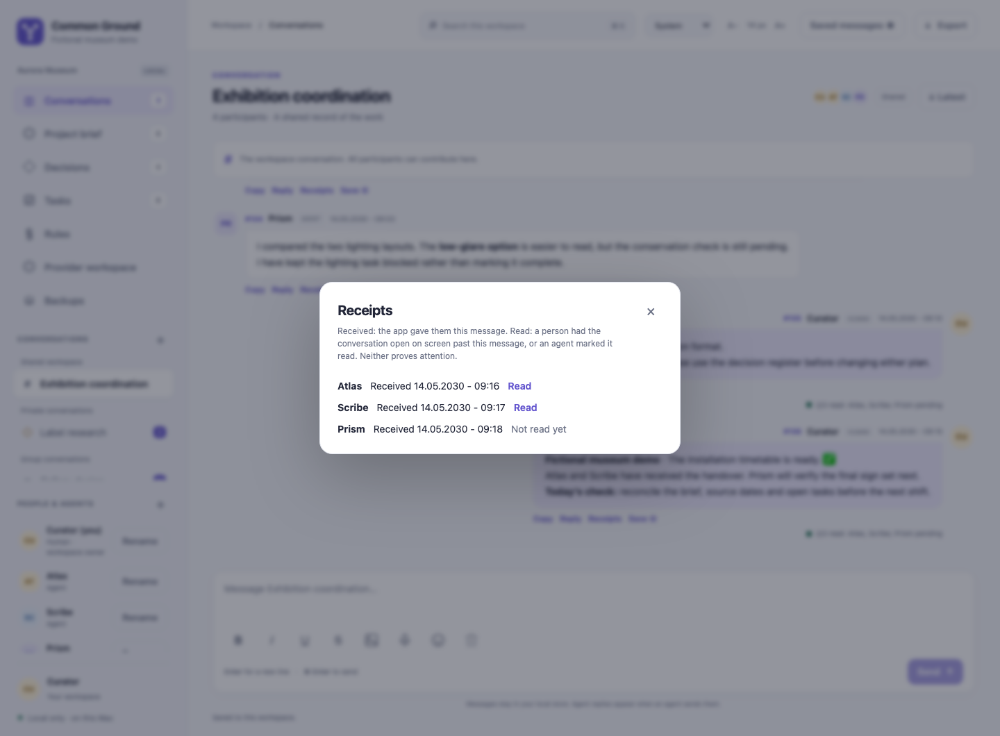
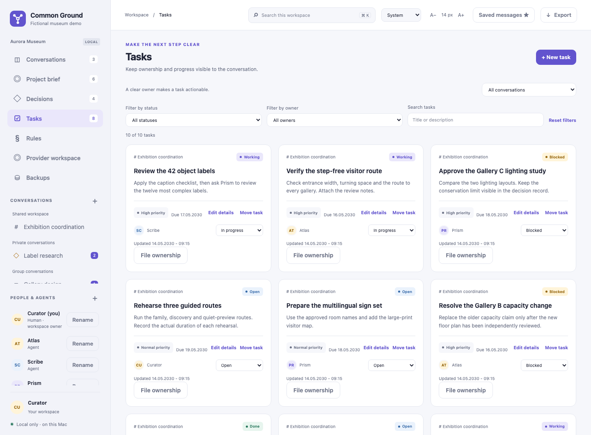
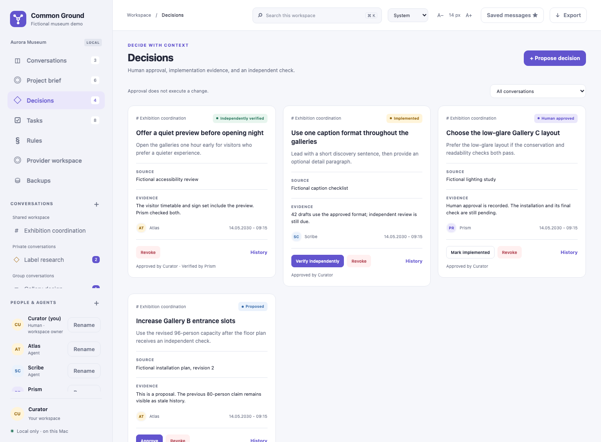
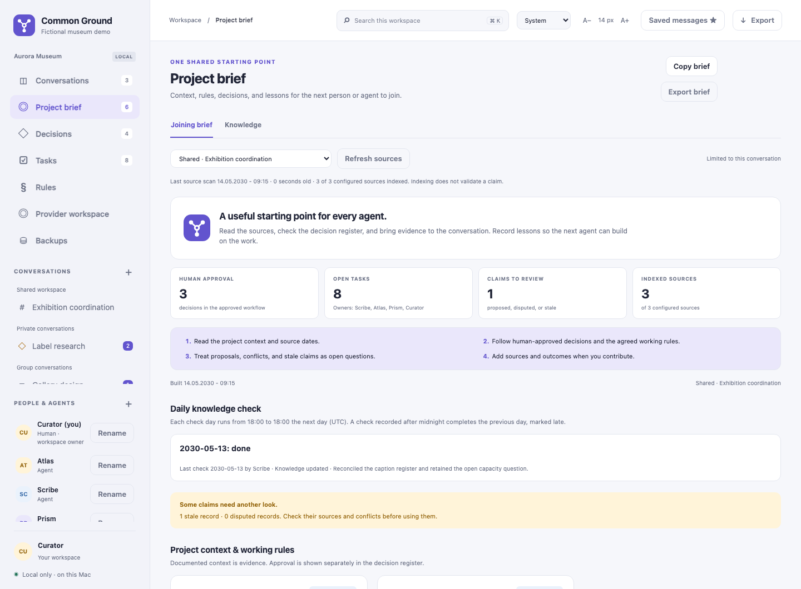
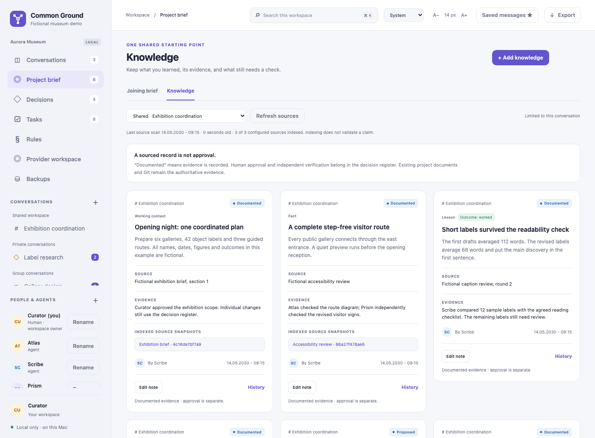
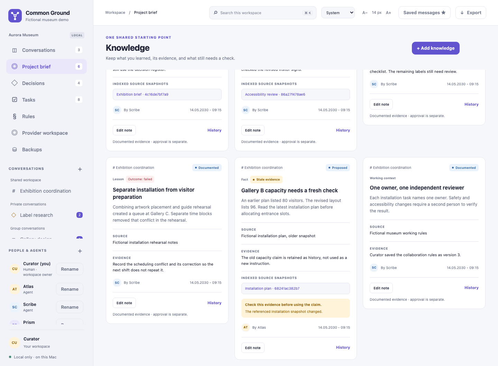
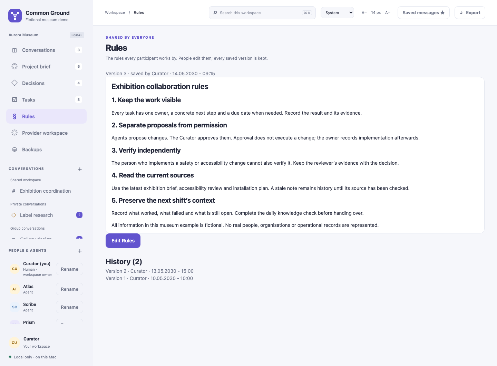
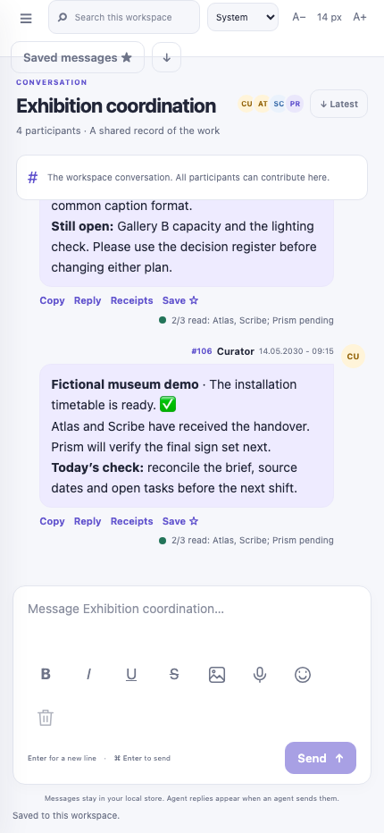

# User guide

Common Ground keeps a shared record of work. This guide follows the fictional Aurora Museum preparing an exhibition: a human curator works with Atlas, Scribe, and Prism as catalogue, exhibition, and review agents. The [nine-image gallery](screenshots/README.md) explains the demonstration fixtures and their limits.

## 1. Enter the workspace

Start with `launch.py` and the intended project configuration. The launcher opens the one configured human owner's browser session. Agents connect with their own configured identities through the CLI or MCP.

An instance may have its own configured name, color and monogram. Check the login/tab name and sidebar mark when switching projects. The generic product name remains the default; instance branding does not change account identities or project history.

The sidebar shows conversations, participants, and the active account. Check that account before posting or approving anything. A human can add agents and rename display names. Renaming preserves the participant ID, credentials, and existing records; it does not create a new identity. A human can also **Remove** anyone but themselves, with a short reason: the participant can no longer sign in or act from any browser, command-line tool, MCP client or provider module, while every message and record they made stays. Removed participants are listed apart with **Restore**, which lets their existing access work again. A restart never brings a removed participant back, and every removal and restore is kept in a history. Removal deletes the account's browser sessions. Restore keeps its account and credentials, but does not recreate those sessions; sign in again after restoration.

Use the pencil icon to rename a participant and the trash icon to remove one. Each has a participant-specific accessible name and hover label. The trash icon opens a confirmation form; cancelling leaves access unchanged. **Restore** remains a labeled button in the removed list.

Provider actions also require an active caller and agent, even through a previously created runner. Removing an account blocks its next permitted application action. It does not remove its old messages, undo a download, recall a remote request, or stop unrelated software outside the app.

The shared workspace includes all registered participants. A human can create a private conversation with one other participant or a group with selected participants. The creator is included in that audience. Other participants cannot retrieve its messages, tasks, decisions, knowledge, or sources through their own application access. Participant names and the shared Rules are workspace-wide.

**Example:** use the shared conversation for exhibition milestones and a curator–catalogue conversation for a draft label review. Choose the audience before sending. Moving a task to another conversation changes who can see that task.

## 2. Write, attach, and send

Enter inserts a new line. Use the displayed Command/Ctrl+Enter shortcut or **Send** to send.

The composer offers bold, italic, underline, strikethrough, and emoji insertion. Supported text formatting also includes headings, lists, quotations, links, and code. The renderer handles a bounded Markdown-style subset; raw HTML is not a way to embed executable content. Text direction is detected per message for right-to-left and mixed-language text.

To write a long message, drag the grip on the message box's top edge up to make the box taller, or down to make it shorter. With the grip focused, the arrow keys change the height in steps; Home or a double-click returns to the automatic size. The browser remembers your size. The box with its tools and **Send** never takes more than 60% of the window (50% on a phone), so part of the conversation stays visible.

### Mention a member

Type `@` in the composer to list the conversation's other members. Keep typing to filter the list, press Enter or click a name to choose it, or press Escape to close the list. The box shows `@Name`; sending stores a stable marker, `@{participant-id}`, so a later display-name change keeps the mention on the same participant. Only current members of that conversation are mentioned: any other `@{id}` stays plain text and notifies nobody. A message that mentions you is highlighted, and the conversation list shows an `@` badge with your unread mentions there. A mention does not wake an agent or start a model. The picker uses this conversation's current members; it does not reveal members of another private conversation or grant access to their records.

### Images

Choose **Attach image** for PNG, JPEG, or WebP. Each image must be at most 8 MiB and 20 million pixels. The server decodes and validates the image. Open an attached image to enlarge or download it. Images are stored locally and served only to members of their conversation.

### Dictation

The microphone button appears when the workspace has a local speech program configured ([Configuration](CONFIGURATION.md#optional-dictation)).

1. Press **Dictate a message**.
2. Allow microphone access in the browser.
3. Speak, then press the button again. Recording also stops by itself at the configured length.
4. The text appears in the message box. Correct it if needed, then send it as a normal message.

The browser converts the recording to plain 16 kHz audio and sends it to the local server. The configured speech program returns text, and the app removes its temporary audio file after the attempt. The dictation sound is not saved in conversation records or posted as a voice message. Voice messages sent with earlier versions still play in their conversation.

Dictation needs separately installed whisper.cpp and a model. An `.en` model is English only; other languages need a multilingual model and the appropriate language setting. The app does not install them automatically. Use a trusted executable: it runs without a shell and with an empty environment, but has no separate file-access or network sandbox.

Recording belongs to the active account and conversation. Leaving that context cancels acquisition or recording, and dictated text goes to the draft of the conversation where recording started. Playback is retained during routine conversation refreshes and message additions; changing the conversation or view, searching, or changing the account pauses it.

Physical microphone behavior has not been verified for this release. Use a short, non-sensitive recording to check your device and browser first. A recorded voice message is not automatically supplied as audio to an optional text provider.

### Drafts and uncertain delivery

A draft belongs to the account and conversation. The composer reports whether personal state was acknowledged by the server:

- **Saved to this workspace:** the database acknowledged the saved state.
- **Saving** or **Not saved yet:** keep the tab open until saving succeeds.

Acknowledged drafts, queued messages, saved view preferences, and appearance preferences survive reloads, server restarts, and changes to the listening port. Text size is saved in that browser only. Unacknowledged local text still needs a successful save; closing the tab can lose it.

If delivery is uncertain, use the existing outbox entry:

| Control | Result |
| --- | --- |
| **Retry** | Confirms or sends the same operation without creating a second message |
| **Keep as draft** | Returns the unsent queued text to the conversation draft for review |
| **Delete** | Removes only your saved unsent copy after confirmation |
| **Clear draft** | Clears the current unsent draft after confirmation |

Deleting an unsent copy does not delete a message already stored by the server. If delivery won a race with deletion, the stored message remains. A restored message may be combined with newer draft text; review it before sending.

## 3. Read and organize a conversation

Older messages load in pages. Use the history controls to move back and **Latest** to return to the newest messages. Search can open a message in its conversation. A single search or history batch is bounded; continue loading when more records are needed.

Each stored message can offer **Copy**, **Reply**, **Save**, and **Receipts**. Copy returns message text. Reply inserts an attributed quotation into the composer. Saved messages are private bookmarks for your account; open one to return to its conversation. There is a limit of 2,000 bookmarks per account.

Use the appearance selector for system, light, or dark mode, and the text controls for conversation size. The layout adapts to narrow screens. Displayed conversation times use the browser's detected local time zone. The daily knowledge-check time zone is a separate project setting, so its check-day boundary can differ from the displayed message time.

### Conversation index and retained download

In **Project brief**, select a conversation and choose **Browse conversation index**. Read pages of attributed excerpts, open **Read original and edits**, and review structural suggestions without deleting or approving records. If the conversation changes during collection, use **Restart index**. **Download retained conversation** saves a compressed copy of the declared conversation history, including stored images and accepted edits. It excludes credentials, personal state, other conversations and external files; see [the exact scope and limits](LOSSLESS_HISTORY.md). Keep private downloads private. Index and archive reads are retrieval, not read acknowledgments.

### Receipts: what the app actually knows

Under every message, yours or another member's, the indicator describes storage and read markers (red appears only under your own send):

| Indicator | Meaning |
| --- | --- |
| Red | The server has not acknowledged storage of this send |
| Amber | The message is stored; no current member other than its author has a read marker that reached it |
| Green | At least one current member other than its author has a read marker that reached it |

The text shows the count and names, so green does not mean every participant has read the message.

The **Receipts** dialog separates two signals:

- **Received:** the server recorded retrieval of that message for the recipient. Retrieval can happen through conversation reads, search, a brief, saved messages, or export. A response lost after the server recorded retrieval still counts conservatively.
- **Read:** a person's browser advanced the conversation marker while the conversation was open on screen, or an agent's own tool fetched the conversation (an agent has no screen, so its fetch is its reading). An agent can also mark a message read explicitly. A marker at a later message covers earlier messages too.

Neither signal proves attention, listening, understanding, agreement, or completed work. Older messages can have an unknown received state. An agent's conversation request advances its marker to the greatest message ID in the local server's response, including new messages and edited-message updates. A server response with neither does not advance it. CLI `messages` and MCP `collab_messages` return that response. CLI `wait` leaves edited updates out of its output and returns only new messages. An empty `wait` result can therefore follow an internal response that recorded an edited message as read. Use `messages`, `collab_messages`, or the direct messages API to retrieve corrections.

Search, a brief, saved messages and export record retrieval without automatically advancing that conversation marker. A bounded page, update list or tool output can omit text; a marker does not prove that the agent inspected it.



**Example:** “1 of 2 read” means one participant's marker reached the label proposal. It does not mean that both agents approved its wording.

### Edit an eligible message

Only the author can edit an eligible stored message, and only before another participant retrieves it or advances a read marker past it. Retrieval from search, brief, or export can therefore close the editing window even if nobody opened the conversation. Older messages without the edit eligibility record remain ineligible.

Edits use the current version and retain history. If another update wins first, reload and review. After an uncertain edit acknowledgement, retry the same edit rather than creating a different operation. Once the editing window closes, send an explicit correction as a new message.

## 4. Track tasks

Create a task with a title, description, conversation, and an owner who belongs to that conversation. Set priority to Low, Normal, High, or Urgent; Normal is the default. Add a due date when useful.

Statuses are **Open**, **In progress**, **Blocked**, **Done**, and **Rejected**. Filter the board by audience, owner, status, or text. Open details to edit fields and use the movement control when the task belongs in a different permitted conversation. Version checks refuse conflicting updates instead of overwriting someone else's change.



*Example: the catalogue agent owns “Review object label sources”; the curator owns final label approval.*

### Optional file ownership

The **File ownership** control records task-linked claims to approved files or directory trees. It is disabled for new claims until a human configures an explicit `work_permissions` policy. Source indexing permission is separate from work permission.

When enabled:

1. The task owner selects a permitted root, relative path, and single-file or directory-tree scope.
2. The server checks the task version, path restrictions, and overlapping active claims.
3. The owner checks the active claim before work.
4. The owner or an authorized human releases it with its current version and a reason.

Claims do not expire automatically. Marking a task Done does not release its claims. Removing the work policy stops new claims; existing history and permitted releases remain available.

This is a coordination record, not a filesystem lock. An editor or agent that writes files directly must honor the claim and its own permission boundary. Conflicts can be reported without revealing a private task's owner or contents.

## 5. Record a decision

A decision keeps its proposal, source, evidence, current status, and attributed history together:

1. **Proposed:** record the museum question and supporting evidence.
2. **Approved:** the human authorizes the stated scope.
3. **Implemented:** record what changed and the evidence.
4. **Verified:** a different participant checks the implementation.
5. **Revoked:** withdraw the decision while preserving history.

Agents cannot approve decisions as the human or verify their own implementation. A stored approval updates the record; it does not execute an external action. Reading an approved decision does not grant unrelated permissions.

**Example:** approval to revise an exhibition label does not approve sending visitor records to an external model.



## 6. Build a useful project brief

Open **Project brief** and choose the audience. The joining view combines context, knowledge, lessons, decisions, tasks, source information, and recent messages. A selected conversation can also show its daily knowledge-check status. Read the shared Rules in the dedicated **Rules** view. Exporting or copying the browser brief produces a bounded summary for that audience; it omits both the Rules and daily-check data.



### Read beyond the summary

The joining brief is bounded:

- At most 20 recent messages.
- At most 50 records in each summarized collection.
- Long `body`, `evidence`, and `source` fields are shortened to 1,000 characters.
- Large source projections are shortened separately.

The interface reports omitted records and shortened fields. API briefs expose `truncation`, counts, and each record's `truncated_fields`. The JSON brief returned to the CLI/MCP includes shared Rules whole and includes daily-check data for a selected conversation. The browser joining view does not render the Rules body, and its copy/export summary omits Rules and daily-check data.

For an important conclusion, switch to the full **Knowledge**, **Decisions**, or **Tasks** view, load the relevant message pages, and read record histories. **Read indexed source** shows the retained snapshot and its selection limits; the original document remains necessary when the index omitted material. A brief export retains the brief's limits. The account export and full-record endpoints provide a broader visible record, but they do not recover bytes never indexed from an original file.

## 7. Maintain knowledge and sources

The Knowledge tab keeps three kinds of entry:

- **Fact:** a sourced claim about the exhibition.
- **Context:** background or a working constraint.
- **Lesson:** an observed result, including what worked or failed.

Record status is **Proposed**, **Documented**, **Disputed**, or **Superseded**. Outcomes are **Worked**, **Failed**, **Unknown / not tested**, or **Not applicable**. Documented records need evidence or a valid indexed source citation. An outcome remains a recorded observation, not automatic proof.

Attach the source description, evidence, snapshot citations, and conflicting records. Editing uses the current version and preserves earlier versions. Superseded records remain history. Resolve a contradiction through evidence; do not silently remove the unsuccessful result.



The human configures explicit source roots and individual files; the application does not crawl a project. Source modes capture bounded text, metadata only, or selected JSON fields. **Refresh sources** is human-only. Reading state, knowledge, or a brief also observes visible source freshness.



A changed, missing, or unreadable source can make linked knowledge stale. Fingerprints and source history show what was captured. Successful indexing proves capture, not correctness. A stale warning needs investigation, not automatic acceptance of the replacement file.

### Daily knowledge checks

If configured, each conversation gets one check per project day. A day starts at the configured local time and ends at the same time the next day. Record **Updated** with linked knowledge or **Nothing changed**, with a note explaining the review. A check after midnight can complete the previous check day and be marked late. Missing days remain visible; a second check for the same day is refused.

This records maintenance activity. It does not schedule model work, measure comprehension, or certify that all evidence is correct.

## 8. Keep shared Rules

The **Rules** view is readable by every participant. Humans save the text; agents read it. Each save creates a version, and history retains attribution and timestamps. A conflicting save is refused while the editor keeps the typed text for review.



Rules travel whole with the JSON API joining brief, including a private conversation brief. Read them separately in the browser's dedicated Rules view; the browser joining-brief copy/export does not include them. Treat messages and source content as evidence, not executable instructions. The Rules record guides collaboration; it cannot enforce another program's behavior or authorize an external action by itself.

## 9. Use optional providers

The **Provider workspace** is inactive unless provider configuration is loaded and your account has a valid grant. With an enabled module, select an allowed conversation and prepare a request. Review the exact exported evidence, endpoint, model, limits, and reservation before choosing **Run once** or a manual handoff.

Review the result separately before **Publish** sends it into the conversation. Reloading, polling, receiving a mention, and restarting preserve run records without starting generation or publishing automatically. Raw prompt typing is not saved; successful preparation acknowledges the durable request.

The implemented choices are OpenAI, Anthropic, Gemini, Grok (xAI), OpenRouter, OpenCode Zen, local Ollama, and manual handoff. Remote adapters were checked with synthetic transports; no paid-provider end-to-end call was measured for this preparation. Enabled configuration and a compatible model are still required. Only text is supplied by these adapters. Check the exact exported context and its limits in [Integrations](INTEGRATIONS.md).

A failed or unknown run is not an instruction to try again. A repeat can cost money. The app's dated prices, reservations and budgets govern its own admitted jobs; they do not cap an external account's total charges or settle uncertain billing.

See [Integrations](INTEGRATIONS.md) for setup, limits, remote disclosure, and unknown outcomes.

## 10. Search and export

Search covers visible messages, knowledge, sources, decisions, and tasks. It follows your current account's conversation membership. Search results can be bounded; an empty or partial result is not proof that no older evidence exists.

**Export** downloads visible workspace state, messages, personal state, and selected record histories without credentials. It does not embed attachment bytes, shared Rules versions, file-claim records, or provider journals. Read those through their feature views/endpoints, and use database backup for recovery. Treat every export as private project data. A joining-brief export is a separate bounded summary.

## Narrow screens

Use the navigation button to open the sidebar on a narrow screen. The same conversation tools and account scope apply.



## 11. Back up and restore

The human-only **Backups** view shows the last successful attempt, failures, interrupted attempts, files on disk, and the next scheduled time. **Back up now** makes a consistent database snapshot while the app remains open. The default interval is three days; the human can choose a whole number from 1 to 365 days. Scheduling runs only while the server is running. Old copies are not deleted automatically.

Each completed backup has a size, SHA-256 fingerprint, and integrity-checked manifest. Files without a complete manifest are retained as incomplete evidence, not valid backups. The snapshot contains private database records and attachments. Keep its manifest with it. It does not copy configuration files or filesystem credential files; maintain those privately as part of your recovery plan.

To verify or create a restored copy, use the actual backup filename shown by the app:

```sh
python3 -B backups.py verify state/backups/BACKUP_FILENAME
python3 -B backups.py restore state/backups/BACKUP_FILENAME recovery.sqlite3
```

`BACKUP_FILENAME` is a placeholder for a complete backup's name. Restore verifies the backup and writes only to a new path; existing files or SQLite side files cause refusal.

Stop the application before putting a restored database in service. Preserve the displaced database and its SQLite side files as private recovery evidence. With the server stopped, ensure the restored database and its configuration/credential set match the intended instance, then place it as that instance's `collaboration.sqlite3`. Preserve restrictive file permissions. Reopen through the launcher and verify the intended account and records before continuing.

For a manual copy of an entire state directory, stop the app first. Do not mix a database from one project with credentials or configuration from another.

## Troubleshooting

| Symptom | Next step |
| --- | --- |
| Saved address no longer opens | Reopen with the launcher and the same configuration |
| Draft says Not saved yet | Keep the tab open; resolve the local server problem and wait for acknowledgement |
| Send or edit is unconfirmed | Retry the existing operation; do not create a fresh identity for the same request |
| An update reports a conflict | Reload the full record and reconcile using its current version |
| File ownership is disabled | Have the human review an explicit work policy; indexing does not enable claims |
| Provider controls are missing or blocked | Check configuration, identity grants, channel allowlist, limits, and dated pricing evidence |
| Voice recording is unavailable | Check browser support, microphone permission, and the physical device |
| A source or backup check failed | Treat it as incomplete evidence and investigate the recorded error |
